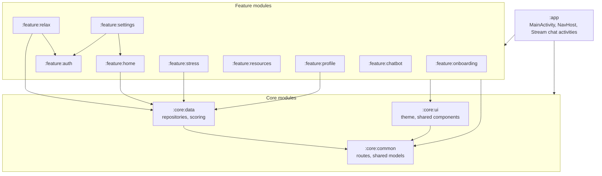
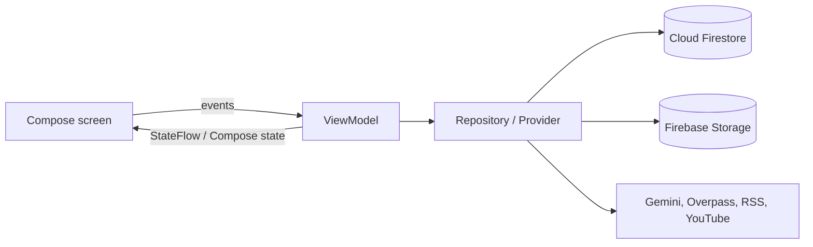
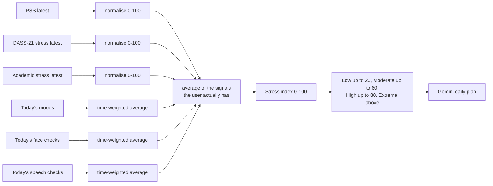

# GetWell+

GetWell+ is an Android app for mental wellness and for reducing the stigma around mental health. Users can measure their stress, depression, anxiety and self-stigma with standard self-assessment questionnaires; log their mood through the day; run on-device face and speech stress checks; and work through guided relaxation, breathing, yoga and CBT-style thought exercises. Gemini powers a supportive chatbot, a daily stress plan and the AI-assisted exercises.

It is written in Kotlin with Jetpack Compose and split into **13 Gradle modules** (an app module, 3 core modules and 9 feature modules), backed by Firebase.

> **Disclaimer:** GetWell+ is a self-help and awareness tool. Its scores are indicative only and are not a medical diagnosis.

---

## Contents

- [Features](#features)
- [Architecture](#architecture)
  - [Module graph](#module-graph)
  - [Layers and state](#layers-and-state)
  - [Navigation](#navigation)
  - [Dependency injection](#dependency-injection)
  - [How the stress index is computed](#how-the-stress-index-is-computed)
  - [Data model (Firestore)](#data-model-firestore)
  - [Background work](#background-work)
  - [External services](#external-services)
- [Tech stack](#tech-stack)
- [Getting started](#getting-started)
- [Permissions](#permissions)
- [Project structure](#project-structure)
- [Roadmap](#roadmap)
- [Contributing](#contributing)
- [License](#license)

---

## Features

### Assess (`feature/stress`)

- **7 self-assessment questionnaires**, each scored in code and stored with a timestamp, with a cool-down before it can be retaken:

  | Questionnaire | Measures | Retake after |
  |---|---|---|
  | DASS-21 | Depression, anxiety and stress subscales | 7 days |
  | PSS (Perceived Stress Scale) | Stress, with reverse-scored items 4, 5, 7, 8 | 30 days |
  | BDI (Beck Depression Inventory) | Depression | 7 days |
  | BAI (Beck Anxiety Inventory) | Anxiety | 7 days |
  | Academic Stress Scale | Study-related stress | 7 days |
  | ISMI (Internalized Stigma of Mental Illness) | Self-stigma | 1 day |
  | DAYS stigma scale | Stigma | 1 day |

- **Face check.** The user takes a photo; ML Kit face detection (contours, landmarks, classification) feeds a rule-based scorer that looks at eye openness, smile probability, eye squint, brow position and jaw-line tension, and returns a stress percentage with the cues it found.
- **Speech check.** Android speech recognition turns a short spoken answer into text; the scorer weighs high- and moderate-stress keywords against positive ones, word repetitions and estimated speaking rate.
- **Today's plan.** The combined stress level (Low, Moderate, High, Extreme) is sent to Gemini, which writes a daily routine: morning, daytime activities, evening wind-down, techniques and self-care.

### Track (`feature/home`, `feature/profile`)

- Mood check-ins with emoji, stored with timestamps.
- Home dashboard with today's stress, depression, anxiety and stigma indices, quick links to the questionnaires, AI stress check, daily plan and daily reflection, and a mental-health fact of the day.
- Profile with an animated mood chart, questionnaire history charts and weekly meditation statistics, all drawn with Compose `Canvas`.

### Relax (`feature/relax`)

| Area | What it includes |
|---|---|
| Physical therapy | Deep breathing, exhalation breathing, restful sleep, meditation with weekly stats, pranayama, and yoga poses, with text-to-speech voice guidance |
| Mental therapy | Guided imagery (Gemini script read aloud with TTS), "Ventilate your feelings" journal with history, irrational-thought control (Gemini reframes a negative thought), "Reaching the point of satiation" thought exercise with Gemini suggestions and past exercises |
| Appraisal of stressor | Questionnaire-based stress appraisal flow |
| Stress-busting games | Bubble game, gradient game, daily reflection with streaks |
| Break the stigma | Stigma awareness quiz |
| Relaxing music | Audio tracks streamed from Firebase Storage |
| Community chatroom | Group chat built on Stream Chat (opened from the Relax screen) |

### Learn and get help (`feature/resources`)

- **Education:** articles pulled from mental-health RSS/Atom feeds (SAMHSA, NIMH, APA, Nursing Times) with an XML pull parser.
- **Practical guides:** a paged feed of curated YouTube videos (Paging 3, page size 5). Titles and thumbnails are scraped with Jsoup and kept in a 100-entry, 24-hour LRU cache.
- **Wellness centres near you:** the device location is sent to the OpenStreetMap Overpass API (via Retrofit) to list hospitals and healthcare facilities within 5 km.
- **Support resources** screen.

### Talk (`feature/chatbot`)

- Gemini 1.5 Flash chatbot with an empathetic system prompt: supportive, non-judgmental, no diagnoses, points to professional or emergency help when needed.
- Conversation stored in Firestore and streamed back in real time through a snapshot listener (`callbackFlow`).
- Offline banner driven by a `ConnectivityManager` network callback.

### Account (`feature/auth`, `feature/onboarding`, `feature/settings`)

- Onboarding, email/password sign-up and sign-in, password reset and change, and Google One Tap sign-in, all through Firebase Auth.
- Settings: account, avatar (uploaded to Firebase Storage), app storage usage (`StorageStatsManager`), privacy and about pages.

---

## Architecture

### Module graph



Rules the modules follow:

- **Features never depend on `:app`.** Screens receive navigation as callbacks or a `NavController`, so the app module is the only place that knows every destination.
- **`:core:common`** holds what everyone needs and nothing heavy: the `Screen` route table, `StressValues`, `RelaxItem` and the signed-in user model.
- **`:core:data`** holds shared data access (Firestore singleton, mood, quiz and stress repositories) and all questionnaire scoring.
- **`:core:ui`** holds the Material 3 theme, fonts, bottom navigation bar and shared components such as the circular progress bar and quiz progress header.

### Layers and state



- Screens are stateless where possible and collect state with `collectAsStateWithLifecycle`.
- ViewModels expose `StateFlow` (for example `StressUIState`: `Loading`, `Success`, `Error`) or Compose `mutableStateOf`, and launch work in `viewModelScope`.
- Repositories wrap Firestore with coroutines (`await()`, `withContext(Dispatchers.IO)`) or `callbackFlow` for real-time listeners.

### Navigation

- One `NavHost` in `app/.../screens/NavigationGraph.kt` with **53 routes**, all declared in the sealed class `Screen` in `:core:common`.
- The start destination is onboarding; if a user is already signed in, the app jumps straight to the home screen and checks which questionnaires are available again based on their cool-downs.
- The community chatroom runs in its own activities (`ChatroomActivity`, `ChannelActivity`) because Stream Chat's Compose UI is activity-based.

### Dependency injection

- Hilt is set up at the application level (`@HiltAndroidApp class StressApp`, `@AndroidEntryPoint MainActivity`).
- `:feature:chatbot` provides the Gemini `GenerativeModel` through a Hilt module, and `:feature:relax` provides `FirebaseAuth`, `FirebaseFirestore` and the application context. Their repositories use `@Inject` constructors, and the chatbot and thought-exercise screens use `@HiltViewModel`.
- Other features use the shared `Injection` Firestore singleton from `:core:data` and simple `ViewModelProvider.Factory` instances.

### How the stress index is computed

All scoring lives in `core/data/.../stressQuiz/ScoreCalculator.kt`.



- Each questionnaire is scored with its own rules (subscale items, reverse scoring, x2 for DASS-21) and then mapped piecewise onto a 0-1 scale using the questionnaire's severity bands.
- Mood, face and speech readings from today are weighted by the time between readings, so a reading that held for longer counts more.
- Signals the user has not provided are left out of the average instead of counting as zero.
- Depression combines BDI and the DASS-21 depression subscale; anxiety combines BAI and the DASS-21 anxiety subscale; stigma combines ISMI and DAYS.

### Data model (Firestore)

```
users/{email}
├── moods/{autoId}                         { id, timestamp }
├── reflections/...                        daily reflection answers and streak
└── StressQuiz/{quizId}/response/{autoId}
        quizId in DASS21, PSS, BDI, BAI, Acad-Stress, ISMI, Days
                  { quizList: [{ id, description, selectedOption }], timestamp }
        quizId in Face, Speech
                  { level, timestamp }

chats/{autoId}                              { userId, content, isUser, timestamp }
meditation_sessions/{userId}/weekly_stats/{yyyy-Www}
feelings/{id}                               journal entries
thoughts/{id}                               thought-exercise entries
```

Firebase Storage holds profile avatars and the relaxing-music audio files.

### Background work

| Worker | Schedule | What it does |
|---|---|---|
| `DailyNotificationWorker` | Periodic, every 24 h, first run at 07:00 | Posts a "Daily Stress Check-in" notification on its own channel |
| `DailyReflectionWorker` | One-time work at 09:00 that re-schedules itself for the next day | Reminds the user to write their daily reflection |

Both are WorkManager `CoroutineWorker`s and are scheduled from `MainActivity`.

### External services

| Service | Used for | Where |
|---|---|---|
| Firebase Auth | Email/password and Google sign-in | `feature/auth` |
| Cloud Firestore | All user data | `core/data`, most features |
| Firebase Storage | Avatars, music | `feature/settings`, `feature/relax` |
| Firebase Analytics, Crashlytics, Performance | Usage, crash and performance reporting | `app` |
| Gemini API (`gemini-1.5-flash`) | Chatbot, daily plan, guided imagery, thought reframing, thought-exercise suggestions | `feature/chatbot`, `feature/stress`, `feature/relax` |
| ML Kit face detection | Face stress check (on device) | `feature/stress` |
| Stream Chat | Community chatroom | `app` |
| OpenStreetMap Overpass API | Nearby healthcare facilities | `feature/resources` |
| RSS/Atom feeds, YouTube | Articles and video guides | `feature/resources` |

---

## Tech stack

| Area | Libraries |
|---|---|
| Language and UI | Kotlin 1.9.25, Jetpack Compose (BOM 2023.08), Material 3, Navigation Compose 2.8 |
| Architecture | Multi-module Gradle (Kotlin DSL), MVVM, Coroutines and Flow, Hilt 2.50 |
| Data | Firebase Auth, Firestore, Storage, Analytics, Crashlytics, Performance |
| AI and ML | Google AI client SDK (Gemini), ML Kit face detection, Android speech recognition and text-to-speech |
| Networking | Retrofit 2.9 + Gson, OkHttp, Jsoup |
| Media and lists | Media3 / ExoPlayer, Paging 3, Coil |
| Background | WorkManager |
| Chat | Stream Chat Compose SDK 6.4 |
| Build | AGP 8.13, `compileSdk` 34, `minSdk` 24, `targetSdk` 34 |

---

## Getting started

### Prerequisites

- Android Studio with support for Android Gradle Plugin 8.13, using **JDK 17** as the Gradle JDK
- Android SDK Platform 34
- A Firebase project
- A Gemini API key from Google AI Studio
- Optional: a Stream Chat API key (only for the community chatroom)

### 1. Clone and open

```bash
git clone https://github.com/OpenLake/GetWelplus-Mental-Health-App.git
```

Open the folder in Android Studio and let Gradle sync.

### 2. Firebase

1. Create a Firebase project and add an Android app with package name `com.example.getwell`.
2. Download `google-services.json` into `app/`. It is git-ignored.
3. Enable **Authentication** (Email/Password and Google), **Cloud Firestore** and **Storage**.
4. For Google sign-in, add your SHA-1 and SHA-256 fingerprints to the Firebase app, then download `google-services.json` again. Get the debug fingerprint with:

   ```bash
   ./gradlew signingReport
   ```

### 3. Secrets

Copy `local.properties.example` to `local.properties` (git-ignored) and fill it in:

```properties
sdk.dir=/path/to/Android/Sdk
GEMINI_API_KEY=your_gemini_api_key
GOOGLE_WEB_CLIENT_ID=your_web_client_id.apps.googleusercontent.com
STREAM_CHAT_API_KEY=your_stream_chat_api_key
```

| Key | Needed for |
|---|---|
| `GEMINI_API_KEY` | Chatbot, daily plan, guided imagery and thought exercises. Injected into `BuildConfig` of `:app`, `:feature:chatbot` and `:feature:relax`. |
| `GOOGLE_WEB_CLIENT_ID` | Google One Tap sign-in (the OAuth web client of your Firebase project) |
| `STREAM_CHAT_API_KEY` | Community chatroom |
| `APP_API_KEY`, `FACEBOOK_*` | Not used by any feature yet; can be left blank |

### 4. Build and run

```bash
./gradlew assembleDebug     # build
./gradlew installDebug      # install on a connected device or emulator
```

Or run the `app` configuration from Android Studio. On first launch the app asks for location, camera, microphone and notification permissions.

---

## Permissions

| Permission | Why |
|---|---|
| `CAMERA` | Face stress check |
| `RECORD_AUDIO` | Speech stress check |
| `ACCESS_FINE_LOCATION`, `ACCESS_COARSE_LOCATION` | Nearby wellness centres |
| `POST_NOTIFICATIONS` | Daily check-in and reflection reminders (Android 13+) |
| `INTERNET`, `ACCESS_NETWORK_STATE` | Firebase, Gemini, feeds; offline banner in the chatbot |
| `PACKAGE_USAGE_STATS`, `READ_NETWORK_STATS` | App storage and data usage in Settings |
| `RECEIVE_BOOT_COMPLETED`, `SCHEDULE_EXACT_ALARM` | Background reminders |
| `VIBRATE` | Haptic feedback in the bubble game and reminders |

---

## Project structure

```
app/                     MainActivity, NavigationGraph (53 routes), Stream chat activities, Hilt application
core/
  common/                Screen routes, shared models (StressValues, RelaxItem, SignInResult)
  data/                  Firestore singleton, mood/quiz/stress repositories, ScoreCalculator, reflections
  ui/                    Material 3 theme, fonts, bottom bar, shared components
feature/
  onboarding/            Two onboarding screens
  auth/                  Firebase email/password + Google One Tap, sign-up, reset, change password
  home/                  Dashboard, mood check-in, fact of the day
  stress/                7 questionnaires, face + speech analysis, Gemini daily plan, daily notification
  relax/                 Breathing, sleep, meditation, pranayama, yoga, CBT exercises, journal, games, music
  resources/             RSS education feed, paged video guides, Overpass wellness-centre finder
  profile/               Mood, quiz and meditation charts
  settings/              Account, avatar upload, storage analyzer, privacy, about
  chatbot/               Gemini chatbot with Firestore history and network monitor
```

Every module is a separate Gradle project with its own `build.gradle.kts`, wired together in `settings.gradle.kts`.

---

## Roadmap

- **Tests.** Only the template unit and instrumented tests exist today. `ScoreCalculator` is pure Kotlin and is the natural first target for unit tests.
- **Chatbot memory.** Each message is sent to Gemini with the system prompt but without earlier turns; passing recent history would make conversations coherent.
- **Clean up unused dependencies.** TensorFlow Lite, CameraX, Vico and ML Kit text recognition are declared in Gradle but not used by any screen.
- **Deep link from the daily notification** straight to the daily plan (the intent extra is set but not handled yet).
- **Consistent DI.** Move the remaining features from manual factories to Hilt.
- **Firestore security rules** scoped per user, checked into the repository.

---

## Contributing

Contributions are welcome. Please read [CONTRIBUTING.md](CONTRIBUTING.md) and the [Code of Conduct](CODE_OF_CONDUCT.md), and report security issues as described in [SECURITY.md](SECURITY.md).

1. Keep each change inside the feature module it belongs to; shared UI goes to `core/ui`, shared data and logic to `core/data` or `core/common`.
2. Build with `./gradlew assembleDebug` and smoke-test the screens you touched.
3. Never commit `local.properties`, `google-services.json`, API keys or keystores.

## License

Released under the [MIT License](LICENSE).
